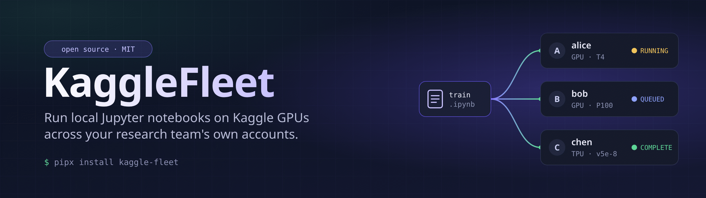
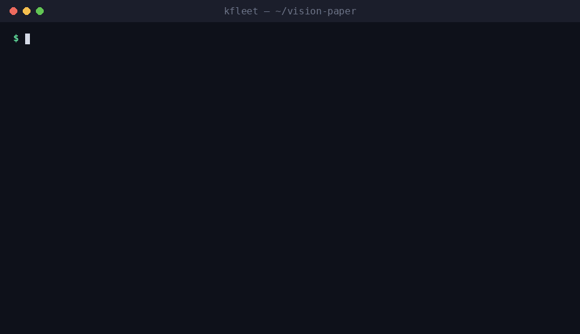
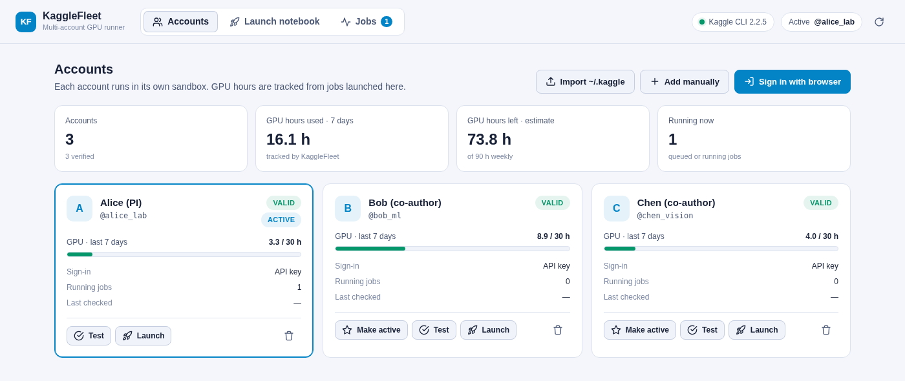
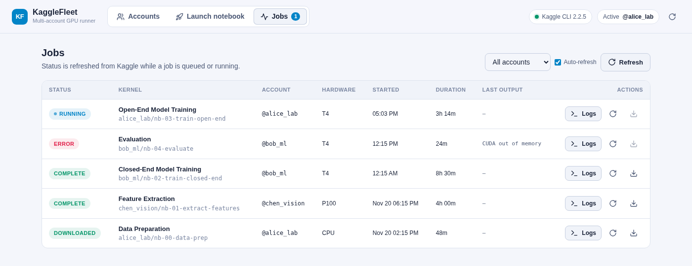

<p align="center">
  
</p>

<p align="center">
  <a href="https://pypi.org/project/kaggle-fleet/"></a>
  <a href="https://pypi.org/project/kaggle-fleet/"></a>
  <a href="https://github.com/towhaEL/KaggleFleet/actions/workflows/ci.yml"></a>
  <a href="https://github.com/towhaEL/KaggleFleet/blob/main/LICENSE"></a>
  
</p>

<p align="center">
  <b>Run your local Jupyter notebooks on Kaggle GPUs, across your research team's own Kaggle accounts,<br>
  from the terminal, a local web panel, or an AI agent.</b>
</p>

<p align="center">
  <a href="#install">Install</a> ·
  <a href="#quick-start">Quick start</a> ·
  <a href="#web-panel">Web panel</a> ·
  <a href="#using-kagglefleet-from-ai-agents-and-scripts">AI agents</a> ·
  <a href="https://github.com/towhaEL/KaggleFleet/blob/main/CHANGELOG.md">Changelog</a>
</p>

<p align="center">
  
</p>

```bash
pipx install kaggle-fleet
kfleet account login --label "Me"
kfleet run push train.ipynb --watch      # runs on a Kaggle GPU, downloads outputs when done
```

## Why KaggleFleet?

Kaggle gives every account a free weekly GPU quota. A research group with several
co-authors has several quotas, but using them means logging in and out of Kaggle,
copying notebooks around, and tracking who ran what. KaggleFleet does that part for you:

- **Keep your notebooks local.** Edit in your own editor and git repo; KaggleFleet stages and pushes them as Kaggle kernels.
- **One machine, many co-author accounts.** Each Kaggle account lives in its own credential sandbox, so runs can go to different accounts at the same time without leaking into each other.
- **Push, watch, collect.** Pick an account and accelerator (T4, P100, TPU or CPU), push, follow status and logs, and download the outputs when the run finishes.
- **A web panel for the team.** Accounts, approximate GPU hours used per account this week, live job status, logs, and one-click launches.
- **Built for AI agents.** Every CLI command has `--json` output and meaningful exit codes, and [`AGENTS.md`](https://github.com/towhaEL/KaggleFleet/blob/main/AGENTS.md) documents the workflow for coding agents.
- **No runtime dependencies** besides the official `kaggle` CLI. The tool itself is pure Python standard library.

| Accounts | Jobs |
|---|---|
|  |  |

> [!IMPORTANT]
> KaggleFleet is for **teams of real people**, each using **their own** Kaggle account with their consent
> (for example co-authors on a paper). Kaggle's [Terms of Use](https://www.kaggle.com/terms) allow one account
> per person. Do not create extra accounts to get more GPU quota. KaggleFleet is not affiliated with Kaggle or Google.

---

## Contents

- [Install](#install)
- [Quick start](#quick-start)
- [Adding co-author accounts](#adding-co-author-accounts)
- [Running notebooks](#running-notebooks)
- [Web panel](#web-panel)
- [Using KaggleFleet from AI agents and scripts](#using-kagglefleet-from-ai-agents-and-scripts)
- [Configuration](#configuration)
- [How credential isolation works](#how-credential-isolation-works)
- [CLI reference](#cli-reference)
- [Limitations](#limitations)
- [Development](#development)
- [Contributing and releases](#contributing-and-releases)

## Install

You need Python 3.9 or newer on **Linux or macOS**. On Windows, use WSL.

```bash
pipx install kaggle-fleet          # recommended: isolated, puts `kfleet` on your PATH
# or
pip install kaggle-fleet
```

To try the latest unreleased code: `pipx install git+https://github.com/towhaEL/KaggleFleet.git`.

This installs two commands, `kfleet` and its longer alias `kaggle-fleet`, and pulls in the official `kaggle` CLI.
Browser sign-in (`kfleet account login`) requires Kaggle CLI 2.x. API-key accounts work with 1.7 and newer.

Check your setup:

```bash
kfleet doctor
```

## Quick start

```bash
cd my-research-project/            # a folder with your notebooks, or a ./notebooks subfolder

kfleet account login --label "Me"  # sign in with your Kaggle account in the browser
kfleet notebook list               # see what KaggleFleet found
kfleet run push train.ipynb --watch
```

To try it on something small first, push [`examples/hello_gpu.ipynb`](https://github.com/towhaEL/KaggleFleet/blob/main/examples/hello_gpu.ipynb), which reports the GPU it got.

With `--watch`, KaggleFleet polls the run until it finishes and then downloads the kernel's
output files to `./outputs/<kernel-slug>/`. Without it, the push returns right away and you can
check on the run later:

```bash
kfleet run list
kfleet run status            # latest job; or pass a job id / kernel slug
kfleet run logs
kfleet run download
```

Or open the web panel:

```bash
kfleet serve --open          # http://127.0.0.1:8080
```

## Adding co-author accounts

Each co-author adds their own account once, on the machine that runs KaggleFleet.

### Option A: browser sign-in (recommended)

```bash
kfleet account login --label "Co-author B"
```

This opens Kaggle's sign-in page in your normal browser. **Whichever Kaggle account is signed in
there is the account that gets added**, so switch the browser to the co-author's account first,
or use `--no-browser` to get a link you can open in a private window or on another device and
paste the verification code back.

The login runs inside a throwaway sandbox. Your own `~/.kaggle` login is never read or changed,
and adding an account that is already configured and valid is refused. If an account has become
**invalid** (for example its token expired or was revoked), sign in again as that account: its
credentials are replaced in place and it keeps its ID and job history.

In the web panel, **Sign in with browser** offers the same flow as a link plus a code field, which
works well when a co-author signs in from their own laptop.

### Option B: API key (`kaggle.json`)

The co-author creates a token at **kaggle.com → Settings → API → Create New Token** and sends you
the `kaggle.json` file, or its username and key:

```bash
kfleet account add --username alice --key 0123456789abcdef... --label "Alice"
```

### Option C: import what is already on this machine

```bash
kfleet account import        # picks up ~/.kaggle/kaggle.json and ~/.kaggle/credentials.json
```

### Managing accounts

```bash
kfleet account list
kfleet account test alice    # checks that the credentials authenticate as *alice*, not just as someone
kfleet account switch alice  # change the default account for pushes
kfleet account remove alice  # deletes the local sandbox only; the Kaggle account is untouched
```

## Running notebooks

```bash
kfleet run push 02_train.ipynb \
    --account bob \
    --accelerator NvidiaTeslaP100 \
    --dataset bob/preprocessed-data \
    --kernel-source alice/nb-00-data-prep \
    --max-runtime 7200 \
    --watch
```

| Option | Meaning |
|---|---|
| `--account`, `-a` | Account id or username. Defaults to the active account. |
| `--accelerator` | `NvidiaTeslaT4` (default), `NvidiaTeslaP100`, `TpuV5E8` or `None` |
| `--no-gpu` | Run on CPU |
| `--no-internet` | Disable internet access inside the kernel |
| `--dataset`, `--competition`, `--kernel-source`, `--model` | Attach Kaggle inputs. Each flag can be repeated. |
| `--title`, `--slug` | Override the kernel title and slug, which are derived from the notebook by default |
| `--max-runtime SECONDS` | Ask Kaggle to stop the kernel after this long. The default is Kaggle's own session limit. |
| `--watch`, `-w` | Wait for completion, then download outputs (turn this off with `--no-download`) |
| `--timeout SECONDS` | How long `--watch` waits. The kernel itself is not affected. |

**Kernel naming.** The kernel title comes from the notebook's first `# heading`. The slug comes from the
file name: `02_train.ipynb` becomes `<username>/nb-02-train`. File names that start with a digit get
a prefix, `nb-` by default; set `KAGGLE_FLEET_SLUG_PREFIX=myproject` to use your project's name instead.
Kernels are always created as **private**.

**Re-running a notebook** pushes a new version of the same kernel. Every push starts a new run on
Kaggle and uses GPU quota.

## Web panel

```bash
kfleet serve                       # http://127.0.0.1:8080
kfleet serve --port 9000 --open
```

The panel has three views:

- **Accounts:** add, test, switch and remove accounts, with each account's estimated GPU hours for the last 7 days.
- **Launch notebook:** pick a notebook, an account and hardware, then push.
- **Jobs:** live status, logs, refresh and download for every run.

The panel has **no login**. It listens on `127.0.0.1` and rejects requests from other websites
(it checks the `Origin` and `Host` headers and requires JSON request bodies). To use it from another
machine, prefer an SSH tunnel over exposing it:

```bash
ssh -L 8080:127.0.0.1:8080 your-gpu-box     # then open http://127.0.0.1:8080 locally
```

The panel is backed by a small JSON REST API, documented in [`docs/rest-api.md`](https://github.com/towhaEL/KaggleFleet/blob/main/docs/rest-api.md).

## Using KaggleFleet from AI agents and scripts

Add `--json` to any command, before or after the subcommand, to get a single JSON document on stdout.
Failures print `{"error": "..."}` and exit with a non-zero code. Account secrets are never printed.

```bash
$ kfleet run push 02_train.ipynb --account bob --json
{
  "success": true,
  "job": {
    "id": "job_20261121_101500_nb-02-train_3f2a",
    "kernel_id": "bob/nb-02-train",
    "status": "RUNNING",
    ...
  }
}

$ kfleet run status job_20261121_101500_nb-02-train_3f2a --json
$ kfleet run logs   job_20261121_101500_nb-02-train_3f2a --json
$ kfleet run download job_20261121_101500_nb-02-train_3f2a --json   # lists the downloaded files
```

[`AGENTS.md`](https://github.com/towhaEL/KaggleFleet/blob/main/AGENTS.md) is a guide written for coding agents such as Claude Code or Codex:
the workflow, the JSON shapes, how to pick an account with spare GPU quota, and what not to do.
Copy it, or link to it, from your research repo's own `AGENTS.md` / `CLAUDE.md`.

## Configuration

| Environment variable | Default | Purpose |
|---|---|---|
| `KAGGLE_FLEET_DIR` | `~/.kaggle_fleet` | State: accounts, credential sandboxes, job history, staging |
| `KAGGLE_FLEET_NOTEBOOKS_DIR` | `./notebooks` if it exists, else `.` | Where notebooks are discovered |
| `KAGGLE_FLEET_OUTPUTS_DIR` | `./outputs` | Where kernel outputs are downloaded |
| `KAGGLE_FLEET_KAGGLE_BIN` | auto-detected | Path to the `kaggle` executable |
| `KAGGLE_FLEET_SLUG_PREFIX` | `nb` | Prefix for slugs derived from file names that start with a digit |

`--notebooks-dir` and `--outputs-dir` override the matching variables for a single command.

## How credential isolation works

Every account gets a private directory, `~/.kaggle_fleet/envs/<account-id>/` (mode `0700`, files `0600`).
Each `kaggle` command for that account runs with:

- `KAGGLE_CONFIG_DIR` pointing at that directory, and
- `HOME` set to a per-account home whose `.kaggle` links to that directory. The Kaggle SDK reads OAuth tokens
  from the hard-coded path `~/.kaggle/credentials.json` and ignores `KAGGLE_CONFIG_DIR`, so without a
  separate `HOME`, every OAuth account would silently run as whoever is logged in to your real `~/.kaggle`.
- Any `KAGGLE_KEY` or `KAGGLE_API_TOKEN` from your shell removed, because those take priority over all other credentials.

When the Kaggle CLI refreshes an OAuth token, the new token is copied back into `accounts.json`.
`kfleet account test` checks the identity Kaggle reports (`kaggle config view`), so a credential
leaking from another account would be caught instead of passing silently.

Credentials are stored **unencrypted** on disk and protected only by file permissions, the same way
the Kaggle CLI stores them. Run KaggleFleet on a machine you trust. See [`SECURITY.md`](https://github.com/towhaEL/KaggleFleet/blob/main/SECURITY.md).

## CLI reference

```
kfleet [--json] [--notebooks-dir DIR] [--outputs-dir DIR] <command>

account   list | add | add-oauth | login | switch | test | remove | import
notebook  list | inspect <notebook>
run       push <notebook> | list | status [job] | logs [job] | download [job]
serve     [--host] [--port] [--open] [--allow-host HOST]
doctor
```

Run `kfleet <command> <subcommand> --help` for every option.
`python -m kaggle_fleet` works the same way as `kfleet`.

## Limitations

- **The GPU hours shown are estimates.** They count only runs launched through KaggleFleet, and a run's end time is when KaggleFleet noticed it finished. Kaggle's own quota page is authoritative.
- **Status is polled.** Status comes from `kaggle kernels status`, so runs are refreshed while you watch them (CLI `--watch` or the web panel) or when you ask (`run status`).
- **Kernels cannot be cancelled from here** because the Kaggle CLI does not support it. Stop a run on kaggle.com.
- **Linux and macOS only** (symlink-based sandboxes). On Windows, use WSL.

## Development

```bash
git clone https://github.com/towhaEL/KaggleFleet.git
cd KaggleFleet
python -m venv .venv && source .venv/bin/activate
pip install -e ".[dev]"

pytest                 # or: python -m unittest discover -s tests -t .
ruff check src tests
```

The test suite never contacts Kaggle: the `kaggle` CLI is mocked or replaced with a fake script.
See [`CONTRIBUTING.md`](https://github.com/towhaEL/KaggleFleet/blob/main/CONTRIBUTING.md).

## Contributing and releases

Bug reports, feature ideas and pull requests are welcome. Please read
[`CONTRIBUTING.md`](https://github.com/towhaEL/KaggleFleet/blob/main/CONTRIBUTING.md) first, and report
security issues privately as described in [`SECURITY.md`](https://github.com/towhaEL/KaggleFleet/blob/main/SECURITY.md).

Releases are listed on the [GitHub releases page](https://github.com/towhaEL/KaggleFleet/releases) and
[PyPI](https://pypi.org/project/kaggle-fleet/). Maintainers: see
[`docs/RELEASING.md`](https://github.com/towhaEL/KaggleFleet/blob/main/docs/RELEASING.md).

## License

[MIT](https://github.com/towhaEL/KaggleFleet/blob/main/LICENSE)
